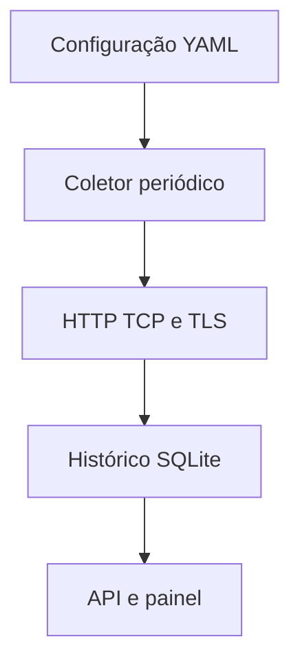

# Service Health Monitor

[](https://github.com/viniciuscaol/service-health-monitor/actions/workflows/ci.yml)

Monitor local de serviços em **Python e FastAPI**, com verificações HTTP, TCP e TLS, histórico SQLite e painel web em português. Projeto de portfólio com uma demonstração reproduzível, sem depender de serviços pagos.

## O que resolve

Reúne em uma tela o resultado mais recente das verificações, o tempo de resposta observado, a validade dos certificados e o histórico por serviço. Permite identificar uma porta fechada, um status HTTP inesperado ou um certificado próximo do vencimento.

| Verificação | Critério |
| --- | --- |
| HTTP | Resposta ao GET com um dos códigos configurados. HTTPS valida certificado e hostname. Não segue redirecionamentos nem baixa o corpo. |
| TCP | Conexão estabelecida com o host e a porta. Não verifica autenticação, consultas ou funcionamento da aplicação. |
| TLS | Handshake com cadeia de confiança e hostname válidos; alerta no período configurado antes do vencimento. Certificados expirados ou não confiáveis resultam em falha. |

O tempo exibido inclui resolução DNS, conexão e, conforme o check, handshake e recebimento dos headers. **Não é uma medição de ping nem de latência de rede isolada.** O estado indica uma observação pontual; o projeto não calcula SLA ou disponibilidade contínua.

## Começar com Docker Compose

Requisitos: Docker Engine e Compose v2 com suporte a `--wait`.

```bash
git clone https://github.com/viniciuscaol/service-health-monitor.git
cd service-health-monitor
docker compose up -d --build --wait
```

Abra **http://localhost:8000**. A primeira rodada começa automaticamente e o painel busca novos resultados a cada cinco segundos. Ele fica publicado somente em `127.0.0.1` por padrão.

A demonstração inclui três serviços:

- Página HTTP local: deve ficar **Disponível**.
- Porta TCP 9000 do mesmo servidor: deve ficar **Disponível**.
- Porta 9001 fechada de propósito: deve ficar **Indisponível**. Esse resultado é esperado.

O servidor de demonstração roda na rede interna do Compose, sem publicar outra porta no computador. **A demonstração padrão não consulta serviços externos nem inclui um alvo TLS.** Os testes automatizados exercitam TLS com uma autoridade certificadora de teste local.

```bash
docker compose ps
docker compose logs --tail=50 monitor
python3 scripts/smoke.py
docker compose down
```

O histórico fica no volume `monitor-data` e é preservado por `down` e recriações dos contêineres. `docker compose down -v` remove esse histórico.

## Configurar seus serviços

Edite `config/services.yml` e reinicie **o monitor**:

```bash
docker compose restart monitor
```

Exemplo para um domínio sob seu controle; substitua os alvos antes de usar:

```yaml
interval_seconds: 60
retention_days: 7
services:
  - id: meu-site
    name: Site institucional
    type: http
    url: https://seu-dominio.example/
    expected_status: [200]
    timeout_seconds: 5
  - id: meu-banco
    name: Porta do PostgreSQL
    type: tcp
    host: servidor-autorizado.example
    port: 5432
    timeout_seconds: 3
  - id: certificado-site
    name: Certificado do site
    type: tls
    host: seu-dominio.example
    port: 443
    warn_days: 30
    timeout_seconds: 5
```

Em Docker, `localhost` aponta para o próprio contêiner, não para o computador hospedeiro. Use um hostname/IP alcançável a partir da rede do monitor. Um redirecionamento HTTP só será aceito se seu código estiver em `expected_status`; ele não é seguido.

| Opção | Padrão e limites |
| --- | --- |
| `interval_seconds` | 60; de 10 a 3600 segundos, contados **após o fim de cada rodada** |
| `retention_days` | 7; de 1 a 30 dias |
| `services` | De 1 a 50 entradas com IDs únicos |
| `timeout_seconds` | 5; de 0,1 a 30 segundos por check |
| `expected_status` | `[200]`; lista de códigos aceitos pelo check HTTP |
| `warn_days` | 30; de 0 a 365 dias, apenas TLS |
| `ca_file` | Opcional, apenas TLS: PEM de uma CA confiável, relativo à pasta do YAML ou absoluto. Não desabilita a validação de hostname. |

Para manter alvos privados fora do Git, use `config/private-services.yml` (já ignorado) e defina `MONITOR_CONFIG=/app/config/private-services.yml` no Compose. Não coloque senhas ou tokens nas URLs. O painel não exibe os alvos e o coletor não armazena corpos de respostas.

Campos desconhecidos, IDs duplicados e configurações inválidas impedem a inicialização. O YAML é lido no início; não há recarga automática. Mudar tipo, alvo, timeout ou critérios de um ID inicia uma nova série de resultados para evitar misturar verificações diferentes.

## Executar sem Docker

Python 3.12. Em um terminal:

```bash
python3 -m http.server 9000 --bind 127.0.0.1 --directory demo
```

Em outro terminal, instale e execute:

```bash
python3 -m venv .venv
source .venv/bin/activate
python -m pip install -r requirements.txt
MONITOR_CONFIG=config/local.example.yml python -m uvicorn monitor.main:app \
  --host 127.0.0.1 --port 8000 --workers 1 --no-access-log
```

No PowerShell, ative com `.venv\Scripts\Activate.ps1` e defina `$env:MONITOR_CONFIG='config/local.example.yml'` antes do comando Uvicorn.

Para executar **uma única rodada**, gravar o histórico e sair:

```bash
python -m monitor --config config/local.example.yml --db data/monitor.db
```

Saída JSON; código 0 quando não há falhas (inclusive atenção por vencimento), 1 se algum alvo estiver indisponível e 2 para configuração/armazenamento inválidos.

## Painel e API

- `/`: painel com resultado mais recente e seleção do histórico de cada serviço.
- `/api/snapshot`: até 50 resultados por serviço, do mais recente ao mais antigo; sem cache.
- `/health`: verifica se o coletor está em execução. Um alvo indisponível **não** torna o contêiner do monitor unhealthy. Se o coletor parar por uma falha interna, retorna 503.
- `/docs`: contrato da API.

O painel distingue **Sem dados**, **Disponível**, **Atenção** e **Indisponível**. Mostra aviso se perder conexão, se o coletor parar ou se os resultados ficarem antigos. O histórico usa UTC no armazenamento e o fuso do navegador na tela. A sequência visual mostra os resultados do mais antigo ao mais recente; a tabela detalha os 10 últimos.

## Como funciona



Até cinco verificações ocorrem em paralelo. O coletor aguarda todas antes de persistir a rodada e iniciar o intervalo. O salvamento da rodada e a remoção de registros fora da retenção são feitos na mesma transação. SQLite usa WAL e conexões curtas. A retenção libera páginas para reutilização; não reduz imediatamente o tamanho do arquivo no disco.

## Testes e integração contínua

```bash
python -m pip install -r requirements-dev.txt
python -m pytest -q
node --check monitor/static/app.js
```

Os testes usam servidores HTTP/TCP/TLS locais, certificados de teste gerados em memória e bancos temporários. Cobrem resposta inesperada, redirecionamento, timeout, porta fechada, cadeia TLS não confiável, hostname divergente, certificado expirado/próximo do vencimento, validação YAML, retenção, persistência e o ciclo de vida do coletor.

O CI executa testes Python e verificação de sintaxe JavaScript, além de construir e subir o Compose para testar a demonstração por HTTP. Ele não publica imagens e não implanta em produção.

## Escopo desta versão

Aplicação para laboratório e uso local, com uma instância e **um worker Uvicorn**. Vários workers criariam coletores duplicados. Não há autenticação, agendamento distribuído, notificações externas, verificação de conteúdo HTTP, STARTTLS, métricas Prometheus ou deploy Kubernetes. Mantenha o painel local; acesso compartilhado exige uma demanda própria de autenticação e implantação.

Um check TCP aprovado não atesta a saúde do banco; um HTTP 200 não garante que todo o fluxo de negócio funcione. Falhas genéricas de conexão/TLS aparecem resumidas; esta versão não faz diagnóstico detalhado da causa.

## Autor e licença

Vinicius Caldas Oliveira · [Portfólio](https://viniciuscaol.site) · [GitHub](https://github.com/viniciuscaol)

Licença [MIT](LICENSE).
